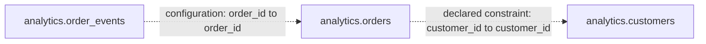

# Relationships

> Generated by TableDossier 0.4.0 from profile run `20261011T190520Z-dd97c5e0`.  
> **Measured at:** 2026-10-11T19:05:20.174Z (UTC) · **Analysis level:** `standard` · **Run status:** `succeeded`.  
> Re-rendering does not refresh measurements: every value below comes from that profile.

Relationships come only from declared constraints or from people (configuration or annotations). TableDossier never infers a relationship from column names, and it did not validate any relationship against the data.

## Known relationships

| Relationship | Origin | From | To | Cardinality | Enforcement | Validation | Scope |
| --- | --- | --- | --- | --- | --- | --- | --- |
| `orders_customer_fk` | declared\_constraint | analytics.orders (customer\_id) | analytics.customers (customer\_id) | _not asserted_ | enforced | not validated (referential validation runs only at the deep level) | declared\_metadata |
| `orders_customer` | configuration | analytics.orders (customer\_id) | analytics.customers (customer\_id) | zero\_or\_more → exactly\_one (provided) | unknown | not validated (referential validation runs only at the deep level) | human\_provided |
| `events_order` | configuration | analytics.order\_events (order\_id) | analytics.orders (order\_id) | _not asserted_ | unknown | not validated (referential validation runs only at the deep level) | human\_provided |

### References without asserted cardinality

These references are not drawn in `erd.mmd` because an ER edge requires a cardinality that the evidence does not determine. This auxiliary diagram only shows direction.

## Referential validation

No relationship was checked against the data in this run. Referential validation runs at the deep level for the relationships selected by `deep.referential`; the Validation column above gives the reason for each relationship.

## Declared keys and constraints

| Table | Constraint | Type | Columns | Expression | Enforcement | Source |
| --- | --- | --- | --- | --- | --- | --- |
| analytics.customers | `customers_pk` | primary\_key | customer\_id | — | enforced | system\_catalog |
| analytics.orders | `orders_customer_fk` | foreign\_key | customer\_id | — | enforced | system\_catalog |
| analytics.orders | `orders_pk` | primary\_key | order\_id | — | enforced | system\_catalog |

Constraints read from the database catalog (`system_catalog`) and marked `enforced` are enforced by PostgreSQL for writes; a constraint added NOT VALID was never checked against the rows that existed before it (see the limitations of the quality report), and enforcement can be bypassed (e.g. session_replication_role = replica), so a declaration alone does not prove the integrity of the data.

## Hypotheses (data-driven, not relationships)

Hypotheses are observations about the data, kept apart from the known relationships above: they are never inferred from column names, have no cardinality and are never drawn in `erd.mmd`. A person must confirm one before declaring it.

No data-driven relationship hypothesis was evaluated (deep level with `deep.relationship_hypotheses.enabled`). Candidate identifiers in the data dictionary are not keys unless an exact uniqueness check says so (quality report).
